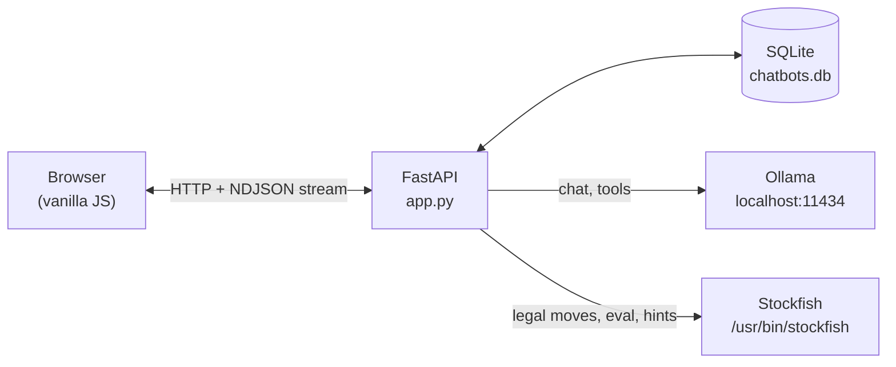
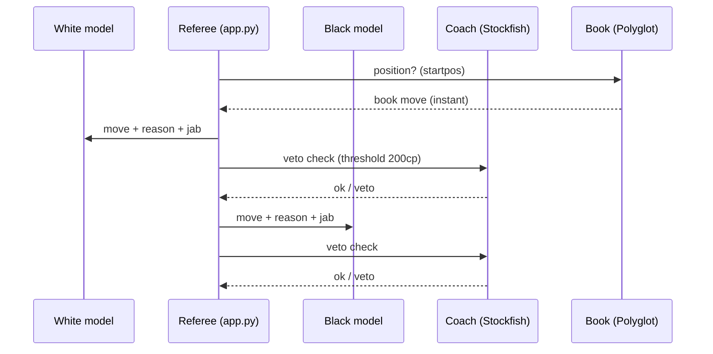

# Lamplight

A personal, local-first chat app that runs on your own machine. Two bots — **After Dark** (NSFW) and **Friend** — with a model per bot, tools, memory, and a chess arena where two local models play each other while you watch (or play one of them).

No accounts, no cloud, no API keys. Everything stays in `chatbots.db` on your disk.

## Features

- **Two bots, two models** — each bot has its own model, system prompt, temperature, and wildness slider. Swap models per message from the composer.
- **After Dark** — adult-oriented roleplay behind an 18+ gate and a passcode lock.
- **Friend** — remembers facts about you across sessions (profile, learned facts, rolling summary).
- **Tools** — `get_time`, `wiki_search`, `remember_fact`, toggled per bot. Multi-round tool loop with streaming responses.
- **Chess arena** — two Ollama models play each other. Stockfish (depth 12) acts as a coach that vetoes blunders; a Polyglot opening book is used when available. Tap **Play** to play one side yourself (legal-move dots, hint button, taunt box). A ringside feed shows the models roasting each other's moves.
- **Backup & export** — download the SQLite DB, or export any chat as Markdown.
- **Passcode lock** — chat, backup, export, and chess endpoints return 423 without the right passcode.

## Architecture



## Quick start

```bash
python -m venv .venv
.venv/bin/pip install -r requirements.txt
# Ollama must be running with at least one model pulled
./run.sh
```

Open `http://localhost:8123` (or `http://<your-lan-ip>:8123` from your phone).

### Run as a systemd user service

```bash
cp chatbots.service ~/.config/systemd/user/
systemctl --user daemon-reload
systemctl --user enable --now chatbots.service
```

`run.sh` detects the running service and steps aside, so the two never fight.

## Chess arena



- Coach threshold: a move losing 200cp or more gets vetoed (max 2 vetoes per move).
- The coach never reveals the best move — only whether your move is acceptable.
- Opening book: place any `.bin` at `books/Performance.bin`.

## Project layout

```
app.py              FastAPI app (chat, tools, prompts, chess)
db.py               SQLite helpers
static/             index.html, app.js, style.css
books/              Polyglot opening book
run.sh              manual runner
chatbots.service    systemd unit
```

## Notes

- Models are managed by Ollama. Pull whatever you want (`ollama pull llama3.2:3b`) and they appear in the model picker.
- The passcode is set from the UI on first run and stored in `chatbots.db`.
- `chatbots.db`, `uploads/`, `tts_cache/`, and `.venv/` are gitignored — they are local data, not source.