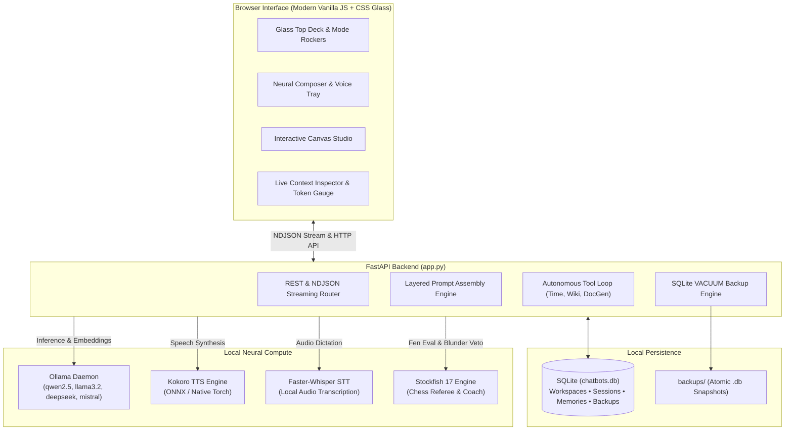
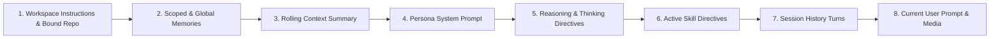

<div align="center">

# 🏮 Lamplight
### Personal, Local-First AI Playground & Neural Workbench

[](LICENSE)
[](https://www.python.org/)
[](https://fastapi.tiangolo.com/)
[](https://www.sqlite.org/)
[](https://ollama.com/)
[](#privacy--security)

*A sovereign, air-gapped personal intelligence environment that unifies multi-persona AI assistants, developer tooling, research desks, creative writing studios, interactive code canvas sandboxes, and local model experimentation.*

[Key Features](#-key-features) • [Architecture](#-architecture) • [Quick Start](#-quick-start) • [Workspaces](#-project-workspaces--context-inspector) • [AI Workbench](#-unified-ai-workbench) • [Security](#-privacy--security)

</div>

---

## 🌟 Overview

**Lamplight** is built for developers and power users who want an autonomous, deeply personalized, local-first AI workspace without corporate telemetry, subscription tiers, or cloud dependencies. 

Everything runs on your own hardware — inference is powered by local Ollama models, neural voice by native Kokoro TTS, transcription by Faster-Whisper, and state is preserved entirely in a local SQLite database (`chatbots.db`).

---

## 🚀 Key Features

### 🎭 4 Specialized Personas
- **After Dark** — Unrestricted, candid, and uncensored intelligence behind an 18+ hardware security lock.
- **Friend** — Warm, conversational companion with long-term memory, profile awareness, and rolling session summaries.
- **Architect** — Production-grade AI systems architect & developer workbench for code review, refactoring, codebase navigation, and technical decision-making.
- **Muse** — Creative writing partner, world-building lorekeeper, story bible manager, and Socratic plot interrogator.

### 📁 Project Workspaces & Context Inspector
- **Project Workspaces**: Isolate custom domain instructions, bound local Git repositories, model preferences, and session histories into scoped containers (e.g., *Lamplight Core*, *Novel Writing*, *Work Engineering*). Switch instantly via the header chip or `Cmd+K` palette.
- **Live Context Inspector**: Open the **Context** tab in the interactive Canvas to visualize the exact layer-by-layer breakdown of what enters the model's context window:
  - Workspace instructions & bound repo metadata
  - Persistent memories & scoped facts
  - Persona system directives & reasoning rules
  - Session history turns (with token weights)
  - Current user prompt
- **Visual Token Gauge**: Real-time token meter tracking consumption against the model's physical context limit with a live HUD counter on the composer bar.

### 🧠 Memory Control Center
- **Scoped Knowledge**: Separate facts into `Global` (available across all personas & workspaces) and `Workspace` (scoped exclusively to the active project).
- **Categorization**: Classify memories into `Fact`, `Preference`, `Project`, `Instruction`, or `Tech Stack`.
- **In-Place Curation**: Search, filter, inline-edit, or prune memories directly from the UI without touching the database manually.

### 🎨 Interactive Canvas & Artifact Studio
- **Live Sandboxing**: Multi-language execution sandbox for HTML, CSS, JavaScript, SVG graphics, Mermaid diagrams, and formatted Markdown.
- **Sandbox Console**: Built-in developer drawer capturing `console.log`, `warn`, and `error` streams directly from the running iframe sandbox.
- **Responsive Viewport Controls**: 1-click device toggles for Desktop (100%), Tablet (768px), and Mobile (375px).
- **Multi-Format Document Export**: 1-click export of any response or canvas artifact to **PDF** (via headless LibreOffice), **Word (.docx)**, **Markdown (.md)**, or a complete **ZIP project bundle**.
- **Version Checkpoints**: Snapshot and rollback artifact code versions with timestamped checkpoint history.

### 🛠️ Unified AI Workbench
- **Model Lab (A/B Bench)**: Side-by-side prompt testing, speed benchmarking (tok/s), and multi-model races.
- **AI Arena**: Stockfish 17 chess bouts where two local models compete with grandmaster coaching, blunder vetoes, ringside banter, or human vs. bot gameplay. Also includes AI Council jury debates.
- **Document Hub**: Multi-file study lab supporting PDFs, DOCX, TXT, and code files with automated flashcard generation and comprehension quizzes.
- **Model Observatory**: Real-time GPU & VRAM telemetry, CPU/RAM monitoring, and instant model eviction controls to free graphics memory.
- **Prompt Library**: Curated template repository with dynamic variable interpolation (`{{variable}}`).
- **Database Backups**: Zero-lock atomic SQLite snapshots via native `VACUUM INTO` engine with automatic rotation and 1-click download.

### 🎙️ Speech, Audio & Web Search
- **Kokoro Neural TTS**: Local, ultra-fast speech synthesis with spring-bouncing audio equalizer visualization.
- **Voice Dictation**: Multi-lingual local speech-to-text powered by Faster-Whisper.
- **Treg Live Web Search**: Optional real-time web search toggle grounding local models with live web knowledge.

---

## 🏗️ Architecture



---

## 🧩 Layered Prompt Assembly

When a message is sent in Lamplight, the **Context Engineering Engine** dynamically constructs a deterministic prompt stack:



---

## 📦 Quick Start

### Prerequisites
- **Python 3.10+**
- **Ollama** installed and running (`ollama serve`)
- At least one model pulled:
  ```bash
  ollama pull qwen2.5:7b-instruct
  ollama pull llama3.2:3b
  ```
- *(Optional)* **Stockfish** installed for the AI Chess Arena (`sudo pacman -S stockfish` or `sudo apt install stockfish`)
- *(Optional)* **LibreOffice** for headless PDF document exports

### Installation

```bash
# Clone the repository
git clone https://github.com/Sumeet-basfore/Lamplight.git
cd Lamplight

# Set up virtual environment
python -m venv .venv
source .venv/bin/activate

# Install dependencies
pip install -r requirements.txt

# Launch Lamplight
./run.sh
```

Navigate to `http://localhost:8123` in your browser (or access via LAN on `http://<your-ip>:8123`).

### 🛡️ First Run & Passcode Lock
On initial startup, Lamplight prompts you to set a hardware authorization passcode. All chat, database, export, and chess endpoints return `HTTP 423 Locked` unless authorized with your passcode.

---

## ⚙️ Running as a Systemd Service

To keep Lamplight running continuously in the background on Linux:

```bash
# Copy user service unit
mkdir -p ~/.config/systemd/user
cp chatbots.service ~/.config/systemd/user/

# Enable and start
systemctl --user daemon-reload
systemctl --user enable --now chatbots.service
```

Check status anytime:
```bash
systemctl --user status chatbots.service
```

---

## 🗂️ Project Structure

```
├── app.py                 # FastAPI application, streaming endpoints & prompt assembly
├── db.py                  # SQLite schema, migration routines & CRUD operations
├── chatbots.service       # Systemd user service unit
├── run.sh                 # Intelligent process runner & service detector
├── requirements.txt       # Python dependencies
├── books/                 # Polyglot opening books for chess engine
├── static/
│   ├── index.html         # Cyber-glass UI layout & modal chassis
│   ├── style.css          # Responsive styling, design tokens & dark themes
│   ├── app.js             # Client state, canvas sandbox, context inspector & API client
│   ├── marked.min.js      # Client-side Markdown parser
│   └── mermaid.min.js     # Client-side diagram renderer
└── backups/               # Automated atomic SQLite database snapshots (gitignored)
```

---

## 🔒 Privacy & Security

- **Zero Cloud Leakage**: No telemetry, analytics, or external API calls. Everything stays strictly on your local loopback.
- **Hardware-Locked**: Session decryption is gated by a local passcode validated using SHA-256 with salt.
- **Air-Gapped Ready**: Operates completely offline without an active internet connection (web search is strictly opt-in).
- **Atomic Backups**: Automated SQLite `VACUUM INTO` snapshots safeguard against database corruption during power loss or hard reboots.

---

## 📄 License

Distributed under the MIT License. See `LICENSE` for more information.